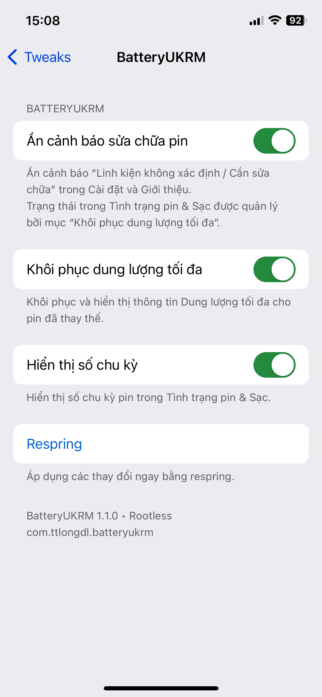
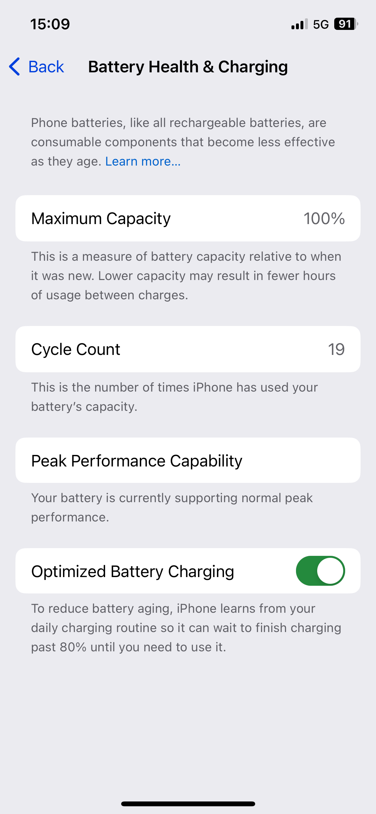
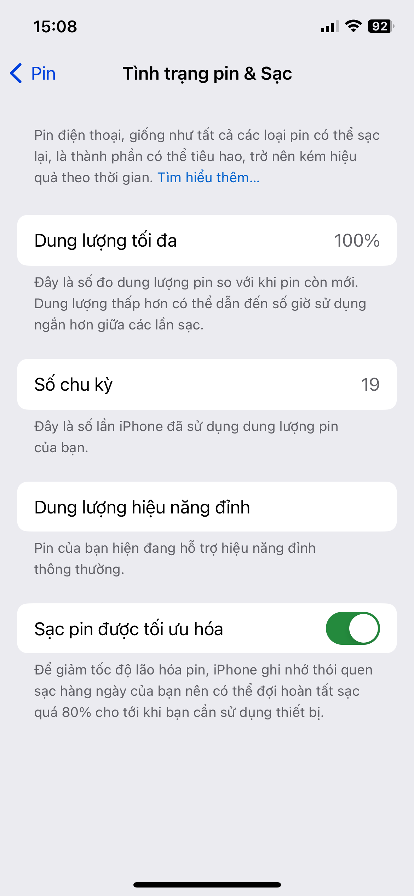
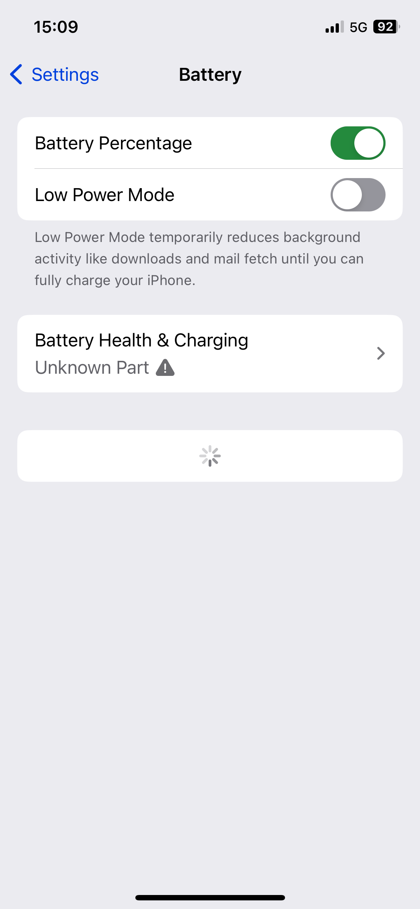

# BatteryUKRM-RH

**English** | [Tiếng Việt](#tiếng-việt)

**BatteryUKRM-RH** is the free **Roothide** edition of BatteryUKRM, a jailbreak tweak for iPhones with replacement batteries. It can hide battery-related **Unknown Part / Repair Needed** warnings, restore the native **Maximum Capacity** display on supported devices, and show the **real battery cycle count** in Settings.

**Version:** 1.1.0 · **Package:** `com.ttlongdl.batteryukrm-rh` · **Jailbreak:** Roothide

> BatteryUKRM changes how battery information and warnings appear in iOS Settings. It does **not** repair a battery, authenticate replacement parts, or improve physical battery capacity. Compatibility depends on the device and iOS version.

## Features

| Feature | What it does |
| --- | --- |
| **Hide Battery Repair Warnings** | Hides battery-related “Unknown Part / Repair Needed” messages in Settings and About, including the Settings repair badge. |
| **Restore Maximum Capacity** | Restores the native Maximum Capacity / Battery Health presentation for supported replacement batteries. |
| **Show Cycle Count** | Reads the actual `CycleCount` from `AppleSmartBattery` and displays it in Battery Health & Charging. |

All three features have **independent switches** in **Settings → Tweaks → BatteryUKRM** and are enabled by default. Tap **Respring** to apply changes. Disabled modules do not install their corresponding hooks.

## Screenshots / Ảnh minh họa

The screenshots below show the **rootless** build on the tested iPhone 12 Pro. BatteryUKRM-RH shares the same preference design, but these screenshots do **not** constitute separate Roothide 1.1.0 testing.

Ảnh chụp từ bản **rootless** trên iPhone 12 Pro đã kiểm thử. Giao diện bản Roothide tương tự, nhưng các ảnh này **không** xác nhận bản Roothide 1.1.0 đã được kiểm thử độc lập.

| English | Tiếng Việt |
| :---: | :---: |
| **Preferences / Tùy chọn** | **Tùy chọn / Preferences** |
|  |  |
| **Battery Health & Cycle Count** | **Tình trạng pin & Số chu kỳ** |
|  |  |
| **Unknown Part warning (before)** | **Cảnh báo linh kiện (trước)** |
|  |  |

**Note:** The displayed **100% Maximum Capacity** and **19 cycles** are readings on the test device, not hard-coded or forced values.

## Roothide testing status

BatteryUKRM-RH **1.0.2** was confirmed working by community testers on real Roothide devices. Version **1.1.0** ports the same modular controls and underlying battery hooks, but has **not yet been fully verified on a dedicated Roothide test device**. The **1.0.2 DEB** is retained in the package repository for rollback.

The screenshots below were taken from the **rootless** build; they illustrate the shared preference UI and Battery Health behavior, **not a separate Roothide 1.1.0 device test**.

## Original rootless reference configuration

- **Device:** iPhone 12 Pro
- **iOS:** 17.0
- **Jailbreak:** Dopamine rootless
- **Battery:** Replacement Apple battery, **without transplanting the original battery BMS/flex**

Other combinations may behave differently. A successful test on one device does not imply universal iOS support.

### Known limitation: iOS 17.7

A real-device report indicates that **Restore Maximum Capacity** may fail on iOS 17.7, leaving that section loading or unavailable. **Show Cycle Count** still worked in that report. If affected, turn **Restore Maximum Capacity** off and respring; the other modules can remain enabled.

**Display/screen repairs:** BatteryUKRM targets battery-related information. Hiding display-replacement warnings is not a verified feature.

## Installation and upgrades

Install the **Roothide** BatteryUKRM-RH package through your preferred compatible package manager, using a release package from this repository. After installation, open **Settings → Tweaks → BatteryUKRM**, select your options, then **Respring**.

Upgrading from **1.0.2** to **1.1.0** keeps the previous default behavior: all three switches start enabled.

## Frequently Asked Questions (FAQ)

### Can BatteryUKRM-RH hide the “Unknown Part” battery warning on a jailbroken iPhone?
BatteryUKRM-RH is the **Roothide** build of BatteryUKRM. Its **Hide Battery Repair Warnings** module is designed to hide battery-related “Unknown Part / Repair Needed” warnings in iOS Settings on compatible devices. Enable the module in **Settings → Tweaks → BatteryUKRM**, then respring. This changes the displayed warning; it does not authenticate the replacement battery.

### Can I restore Battery Health / Maximum Capacity after replacing an iPhone battery?
The **Restore Maximum Capacity** module can restore the native Maximum Capacity presentation on supported device/iOS combinations. It does not increase the battery’s actual capacity or guarantee a correct percentage on every device.

### Does it show the real battery cycle count?
The **Show Cycle Count** module reads `CycleCount` from `AppleSmartBattery` rather than inserting a fixed number. Availability and presentation depend on iOS compatibility.

### Does BatteryUKRM-RH require transplanting the original battery BMS or flex cable?
The original **rootless** BatteryUKRM was tested with a replacement Apple battery **without transplanting the original BMS/flex**. That is a reference test, **not independent verification** of every Roothide device and battery combination.

### Is BatteryUKRM-RH compatible with Roothide, Dopamine rootless, and iOS 17?
This repository contains the **Roothide** package (`com.ttlongdl.batteryukrm-rh`). For **Dopamine rootless**, use the separate [BatteryUKRM rootless repository](https://github.com/ttlongdl/BatteryUKRM). Community testers confirmed **Roothide 1.0.2**; **Roothide 1.1.0** still needs broader real-device testing. Compatibility varies by iOS version.

### Why is Maximum Capacity stuck loading on iOS 17.7?
The shared battery-hook implementation has a reported iOS 17.7 compatibility issue. Try disabling **Restore Maximum Capacity** and respringing. This symptom alone does not prove a battery hardware fault.

### Does it hide replaced-display / screen warnings?
No such support has been verified. BatteryUKRM-RH targets **battery-related** information.

## Câu hỏi thường gặp (FAQ tiếng Việt)

### Làm sao ẩn cảnh báo “Linh kiện không xác định” của pin trên iPhone jailbreak Roothide?
BatteryUKRM-RH có module **Ẩn cảnh báo sửa chữa pin** nhằm ẩn cảnh báo liên quan đến pin trong Cài đặt trên thiết bị tương thích. Bật module tại **Cài đặt → Tweaks → BatteryUKRM** rồi **Respring**. Tweak chỉ thay đổi cách hiển thị, **không xác thực pin thay thế**.

### Thay pin iPhone rồi có hiện lại Tình trạng pin / Dung lượng tối đa được không?
Module **Khôi phục dung lượng tối đa** có thể khôi phục giao diện hiển thị gốc trên một số cấu hình tương thích; **không làm tăng dung lượng pin thực** và không bảo đảm hoạt động trên mọi phiên bản iOS.

### Tweak có hiện số chu kỳ sạc pin thật không?
Module **Hiển thị số chu kỳ** đọc `CycleCount` từ `AppleSmartBattery`, không gán số chu kỳ cố định. Khả năng hiển thị phụ thuộc thiết bị và iOS.

### Có cần chuyển mạch BMS/flex của pin cũ sang pin mới không?
Bản **rootless gốc** đã được kiểm tra trên iPhone 12 Pro iOS 17.0 với pin Apple thay thế **không chuyển mạch BMS/flex**. Đây **không phải** xác nhận độc lập cho mọi thiết bị Roothide.

### BatteryUKRM-RH khác gì BatteryUKRM rootless?
**BatteryUKRM-RH** dành cho **Roothide**; bản [BatteryUKRM](https://github.com/ttlongdl/BatteryUKRM) dành cho **rootless / Dopamine**. Roothide 1.0.2 đã có người dùng xác nhận; 1.1.0 cần kiểm thử thực tế thêm.

### Vì sao iOS 17.7 bị xoay vòng ở mục Dung lượng tối đa?
Có báo cáo lỗi tương thích hook trên iOS 17.7. Hãy thử tắt **Khôi phục dung lượng tối đa** rồi respring; không nên kết luận pin hỏng chỉ dựa vào hiện tượng này.

### Có ẩn được cảnh báo thay màn hình không?
Chưa được xác minh. Tweak chỉ tập trung vào **linh kiện pin**.

## Tiếng Việt

**BatteryUKRM-RH** là phiên bản **Roothide** miễn phí của BatteryUKRM dành cho iPhone jailbreak, tập trung vào việc khôi phục cách hiển thị thông tin pin sau khi thay pin, đồng thời ẩn các cảnh báo linh kiện pin không xác định trong Cài đặt.

**Phiên bản:** 1.1.0 · **Package:** `com.ttlongdl.batteryukrm-rh`

> Tweak chỉ thay đổi cách iOS **hiển thị** thông tin và cảnh báo liên quan đến pin. Tweak **không sửa chữa pin**, không xác thực linh kiện thay thế và không làm tăng dung lượng thực tế của pin.

### Tính năng

| Tính năng | Mô tả |
| --- | --- |
| **Ẩn cảnh báo sửa chữa pin** | Ẩn cảnh báo “Linh kiện không xác định / Cần sửa chữa” liên quan đến pin trong Cài đặt và Giới thiệu, bao gồm biểu tượng cảnh báo sửa chữa. |
| **Khôi phục dung lượng tối đa** | Khôi phục mục Dung lượng tối đa / Tình trạng pin trên các cấu hình thay pin tương thích. |
| **Hiển thị số chu kỳ** | Đọc giá trị `CycleCount` thực từ `AppleSmartBattery` và hiển thị trong Tình trạng pin & Sạc. |

Ba tính năng có **công tắc riêng**, mặc định đều bật. Vào **Cài đặt → Tweaks → BatteryUKRM**, chọn tính năng cần dùng rồi nhấn **Respring**. Khi tắt một module, tweak sẽ không cài đặt các hook tương ứng của module đó.

Giao diện tùy chọn hỗ trợ **tiếng Việt và tiếng Anh** theo ngôn ngữ hệ thống.

### Tình trạng thử nghiệm Roothide

Bản **1.0.2** đã được người dùng xác nhận hoạt động trên thiết bị Roothide thực tế. Bản **1.1.0** đã chuyển các module và giao diện tùy chọn sang Roothide, nhưng **chưa được kiểm tra đầy đủ trên thiết bị Roothide riêng**. Gói DEB **1.0.2** vẫn được giữ trong repo để quay lại khi cần.

Các ảnh minh họa là từ bản **rootless**, không phải bằng chứng đã kiểm thử Roothide 1.1.0.

### Cấu hình tham chiếu từ bản rootless

- **iPhone 12 Pro**, **iOS 17.0**, **Dopamine rootless**
- Đã thay bằng pin Apple khác, **không chuyển mạch BMS/flex của pin gốc**

**Lưu ý iOS 17.7:** Có báo cáo thực tế cho thấy mục **Khôi phục dung lượng tối đa** có thể không hoạt động và bị xoay tải. Trong trường hợp này, hãy tắt riêng tính năng đó rồi respring. Tính năng hiển thị số chu kỳ vẫn hoạt động trên thiết bị được báo cáo.

**Màn hình thay thế:** Chưa xác minh khả năng ẩn cảnh báo liên quan đến màn hình. BatteryUKRM chỉ tập trung vào thông tin **pin**.

### Cài đặt / Nâng cấp

Cài gói **Roothide** từ bản phát hành của repository bằng trình quản lý gói tương thích. Sau đó mở **Cài đặt → Tweaks → BatteryUKRM** và respring để áp dụng.

Nâng cấp từ **1.0.2** lên **1.1.0** sẽ giữ hành vi mặc định trước đây vì cả ba tính năng đều được bật sẵn.
